# sharks-game

**English** | [繁體中文](README.zh-TW.md)

A game in your terminal: you are the smallest shark in a sea full of fish schools and bigger sharks. Eat fish, grow, and become the biggest shark in the sea. A small (~400 KB), dependency-free Rust program in 24-bit colour, built from [ascii-sharks-term](https://github.com/anson1eechun/ascii-sharks-term), the terminal port of [stackedlol/ascii-sharks](https://github.com/stackedlol/ascii-sharks).

<p align="center">
  
</p>

<p align="center">
  
</p>

<sub>Both recorded from the renderer itself, frame by frame, as SVG; an autopilot plays the game.</sub>

## How to play

```sh
sharks-game
```

The title screen opens over the live sea. Pick your shark (it swims in the window on the right), how many rivals you want, and **Start**. `sharks-game -p` skips straight into a game.

The menus are drawn with depth: raised panels lit from above that cast soft shadows, a recessed preview window with shafts of light, an embossed logo textured with the same ASCII skin as the sharks, and caustic light drifting over all of it. The sea behind keeps moving, dimmed and vignetted.

You start as the smallest shark. Every fish you eat makes you longer, and growth slows as you get bigger. The status line along the top shows your size, the fish you have eaten, your rank by length, and whether your dash is ready. Overtake every other shark to become the biggest in the sea; that takes a few minutes. The game carries on afterwards, so you can keep growing.

| Controls | |
|---|---|
| Arrows, `WASD`, `hjkl` | Swim that way. Sharks never stop, so yours keeps going until you turn it. |
| Mouse | Your shark heads for the pointer, slowing as it gets close. |
| Space, click | Dash: a burst of speed for half a second, ready again every 2 s. |
| `Esc`, `p` | Pause menu: resume, restart, how to play, main menu, quit. |
| `Ctrl-Z` | Suspend; `fg` brings it back. |
| `q`, `Ctrl-C` | Quit (on the title screen, `Esc` too). |

Your shark has a gold outline, and is tagged for the first few seconds. A terminal never says when a key is let go, so the keys set a direction rather than being held down.

**Tips.** Fish notice your shark later than the other sharks, and your bite is wider, but a school still scatters when you come close. Cut into a school from the side, or dash at the last moment. The other sharks hunt the same fish, so a school they are chasing goes fast.

## Install

```sh
cargo install --locked --git https://github.com/anson1eechun/ascii-sharks-game
```

Or build it yourself:

```sh
git clone https://github.com/anson1eechun/ascii-sharks-game
cd ascii-sharks-game
cargo run --release
```

It needs Rust 1.88 or later. **Platforms:** macOS and Linux. On Windows, use WSL.

## Options

```sh
sharks-game                          # a random shark against three others
sharks-game -k hammerhead            # play as a hammerhead (sharks-game -l lists the kinds)
sharks-game -k tiger -o greathammer  # a tiger shark against one great hammerhead
sharks-game -n 6                     # six other sharks
sharks-game -n 0                     # just you and the fish
sharks-game --seed 7                 # the same sea again
```

| Game | |
|---|---|
| `-p, --play` | Skip the title screen and start right away. |
| `-k, --shark <kind>` | Your shark (default: random). The title screen starts on it. |
| `-o, --others <kind,...>` | The other sharks, such as `tiger,mako`. You can repeat a kind. |
| `-n, --count <n>` | How many other sharks, 0–11 (default 3). Ignored with `-o`. |
| `--fish <n>` | How many fish, 1–1000 (default: by window size). |
| `--seed <n>` | Play the same sea again. |
| `--speed <x>` | Game speed, 0.1–5 (default 1). |
| `-l, --list` | List the shark kinds. |

| Display | |
|---|---|
| `-f, --fps <n>` | Frames per second, 1–120 (default 30). |
| `--color <mode>` | `auto` (default), `truecolor`, `256`, `16` or `mono`. |
| `--ascii` | ASCII glyphs only. |
| `--aspect <n>` | Cell height ÷ width, if the detected one looks off. |
| `--calm` | No shimmer or flicker on the sharks. |
| `-V, --version` / `-h, --help` | |

The window can be resized during a game: the sea keeps its scale, and schools swim in to fill new space.

### Shark kinds

| Name | Shark |
|---|---|
| `classic` | Classic requiem shark, cool blue-grey |
| `hammerhead` | Smooth hammerhead: swept-back head, bronze-olive |
| `greathammer` | Great hammerhead: wide, straight, notched head and a towering dorsal |
| `tiger` | Tiger shark: blunt snout, barred back |
| `mako` | Shortfin mako: conical snout, torpedo body, metallic indigo |
| `thresher` | Thresher shark: a whip of a tail as long as its body |
| `nurse` | Nurse shark: broad head, paddle fins, tawny |
| `zebra` | Zebra shark: spotted, with a long ribbon tail |

### Colours and language

Colours follow the terminal: `NO_COLOR` turns them off, `COLORTERM=truecolor` gives 24-bit, the Linux console gets 16 and macOS Terminal 256; override with `--color`. Terminals that draw ambiguous-width glyphs two columns wide are detected. Messages follow your locale (`LC_ALL`, `LC_MESSAGES`, `LANG`); set `SHARKS_LANG=en` or `SHARKS_LANG=zh-TW` to choose.

## Performance

In a 200×55 terminal on Apple Silicon, with four sharks and about 880 fish: around 12% of one CPU core at 30 fps, and 2.5 MB of memory. Most of the cost is the fish schooling and the anti-aliased shark rendering (five samples per cell). `-f 20` or `--fish 300` make it lighter.

## Development

```sh
cargo test --release                                       # unit tests, plus the game driven through a pseudo-terminal
cargo test --release balance -- --ignored --nocapture      # how fast an autopilot grows, by window size
SHARKS_DEMO=docs cargo test --release write_demos          # redraw the animations in docs/
SHARKS_STILL=/tmp cargo test --release still_of_the_game   # single frames of the game and each menu page, as SVG
```

The difficulty is tuned with that autopilot, which steers for the thickest school nearby four times a second: it becomes the biggest shark in about one to four minutes at 90×28, 140×40 and 200×55. A test keeps it under four minutes. The knobs are `PLAYER_*` in `src/world.rs` and `START_SIZE`, `FULL_SIZE` and `APPETITE` in `src/game.rs`.

| Path | |
|---|---|
| `src/game.rs` | The rules: steering, dashes, growth, rank, the status line, and the autopilot used in tests |
| `src/menu.rs` | The title, pause and help screens, and the shark preview |
| `src/ui.rs` | Drawing with depth: slabs, shadows, wells, the embossed logo, caustics |
| `src/setup.rs` | Which sharks share the sea, and how big they are |
| `src/world.rs` | The sea: fish schools, the hunting sharks, and how the player's shark swims and bites |
| `src/renderer.rs` | Sharks, fish and wakes drawn into cells |
| `src/app.rs` | The frame loop, keyboard and mouse |
| `src/term.rs` | Terminal I/O on plain libc: raw mode, size, signals, the startup probe |
| `src/screen.rs` | The writer: only changed cells, in 24-bit, 256, 16 or no colour |
| `src/input.rs` | Keys, arrows and SGR mouse reports from raw bytes |
| `src/grid.rs` | The cell grid everything draws into, with wide-glyph support |
| `src/cli.rs`, `main.rs` | Options and wiring |
| `src/demo.rs`, `docs/` | The README animations. CI checks they are up to date |
| `tests/` | The binary driven through a pseudo-terminal: the title menu, keys, pause, resizing, Ctrl-Z |

## Credits

The fish schooling, the shark designs and the look come from [ascii-sharks](https://github.com/stackedlol/ascii-sharks) by drewdi, released under the MIT License, by way of [ascii-sharks-term](https://github.com/anson1eechun/ascii-sharks-term), which brings them to the terminal. This project turns them into a game.

## License

[MIT](LICENSE): free to use, modify and distribute, including commercially. Keep the copyright notices, including the original author's.
