# sharks-game

[English](README.md) | **繁體中文**

終端機裡的小遊戲：你是海裡最小的鯊魚，周圍有成群的魚，也有比你大的鯊魚。吃魚、長大，成為這片海裡最大的鯊魚。程式用 Rust 寫成，執行檔約 400 KB，不依賴任何套件，24-bit 全彩。畫面和魚群來自 [ascii-sharks-term](https://github.com/anson1eechun/ascii-sharks-term)，也就是 [stackedlol/ascii-sharks](https://github.com/stackedlol/ascii-sharks) 的終端機移植版。

<p align="center">
  
</p>

<sub>由程式的渲染器逐幀錄製成 SVG，畫面中由自動駕駛操控。</sub>

## 怎麼玩

```sh
sharks-game
```

你從最小的鯊魚開始。每吃一條魚身體就變長一點，越大長得越慢。頂端的狀態列會顯示體型、吃了幾條魚、你在所有鯊魚裡的體長排名，以及衝刺能不能用。超過其他所有鯊魚，你就是這片海裡最大的鯊魚，大約要玩幾分鐘。之後遊戲會繼續，你可以一直長下去。

| 操作 | |
|---|---|
| 方向鍵、`WASD`、`hjkl` | 往那個方向游。鯊魚不會停下來，所以會一直往前游，直到你讓牠轉彎。 |
| 滑鼠 | 你的鯊魚會游向游標，靠近時放慢。 |
| 空白鍵、點擊 | 衝刺：半秒的爆發加速，每 2 秒可以用一次。 |
| `p` | 暫停。 |
| `Ctrl-Z` | 暫停到背景，用 `fg` 叫回來。 |
| `q`、`Esc`、`Ctrl-C` | 離開。 |

你的鯊魚有金色輪廓，開場前幾秒還會標上「你」。終端機收不到「放開按鍵」的事件，所以按鍵是設定方向，而不是要一直按著。

**小技巧**：魚會比較晚才發現你，你的嘴也比其他鯊魚大，但靠得太近魚群還是會散開。從側面切進魚群，或在最後一刻衝刺。其他鯊魚也會搶同一批魚，被牠們追著的魚群很快就會被吃光。

## 安裝

```sh
cargo install --locked --git https://github.com/anson1eechun/ascii-sharks-game
```

或自己編譯：

```sh
git clone https://github.com/anson1eechun/ascii-sharks-game
cd ascii-sharks-game
cargo run --release
```

需要 Rust 1.88 以上。**支援平台**：macOS 和 Linux。Windows 請用 WSL。

## 選項

```sh
sharks-game                          # 隨機一種鯊魚，對上另外三隻
sharks-game -k hammerhead            # 用雙髻鯊來玩（sharks-game -l 可以看清單）
sharks-game -k tiger -o greathammer  # 虎鯊對上一隻無溝雙髻鯊
sharks-game -n 6                     # 另外放 6 隻鯊魚
sharks-game -n 0                     # 只有你和魚
sharks-game --seed 7                 # 重玩同一片海
```

| 遊戲 | |
|---|---|
| `-k, --shark <種類>` | 你的鯊魚，預設隨機。 |
| `-o, --others <種類,...>` | 其他鯊魚，例如 `tiger,mako`。同一種可以重複。 |
| `-n, --count <n>` | 其他鯊魚的數量，0～11，預設 3。有 `-o` 時不使用。 |
| `--fish <n>` | 魚的數量，1～1000，預設依視窗大小決定。 |
| `--seed <n>` | 重玩同一片海。 |
| `--speed <x>` | 遊戲速度，0.1～5，預設 1。 |
| `-l, --list` | 列出所有鯊魚種類。 |

| 顯示 | |
|---|---|
| `-f, --fps <n>` | 每秒畫面數，1～120，預設 30。 |
| `--color <模式>` | `auto`（預設）、`truecolor`、`256`、`16` 或 `mono`。 |
| `--ascii` | 只用 ASCII 字元。 |
| `--aspect <n>` | 字元格的高寬比，偵測到的結果看起來不對時才需要設定。 |
| `--calm` | 鯊魚身上不閃爍、不變色。 |
| `-V, --version` / `-h, --help` | |

遊戲中可以隨時調整視窗大小：海會維持原本的比例，新增的空間會有魚群游進來填補。

### 鯊魚種類

| 名稱 | 鯊魚 |
|---|---|
| `classic` | 經典真鯊，冷調藍灰色 |
| `hammerhead` | 錘頭雙髻鯊：頭翼往後掠，古銅橄欖色 |
| `greathammer` | 無溝雙髻鯊：頭翼又寬又直，中間有缺口，背鰭高聳 |
| `tiger` | 虎鯊：吻部方鈍，背上有條紋 |
| `mako` | 尖吻鯖鯊：圓錐形尖吻，魚雷般的身形，金屬靛藍色 |
| `thresher` | 長尾鯊：尾巴像一條和身體一樣長的鞭子 |
| `nurse` | 鉸口鯊：頭部寬闊，槳狀胸鰭，黃褐色 |
| `zebra` | 豹紋鯊：滿身斑點，尾巴像一條長緞帶 |

### 色彩與語言

色彩會配合終端機：`NO_COLOR` 會關閉色彩，`COLORTERM=truecolor` 用全彩，Linux 主控台用 16 色，macOS 內建終端機用 256 色；也可以用 `--color` 指定。會自動偵測把模糊寬度字元畫成兩格寬的終端機。訊息語言依語系而定（`LC_ALL`、`LC_MESSAGES`、`LANG`），也可以用 `SHARKS_LANG=en` 或 `SHARKS_LANG=zh-TW` 指定。

## 效能

在 Apple Silicon、200×55 的終端機裡，4 隻鯊魚、約 880 條魚：30 FPS 時約佔單核 CPU 的 12%，記憶體 2.5 MB。大部分花在魚群的群體行為和鯊魚的抗鋸齒繪製（每格取樣 5 次）。用 `-f 20` 或 `--fish 300` 可以更省資源。

## 開發

```sh
cargo test --release                                       # 單元測試，加上透過虛擬終端機實際操作遊戲
cargo test --release balance -- --ignored --nocapture      # 看自動駕駛在各種視窗大小下長得多快
SHARKS_DEMO=docs cargo test --release write_demos          # 重新產生 docs/ 裡的動畫
```

難度是用這個自動駕駛調出來的：它每秒看 4 次，朝附近最密的魚群游過去。在 90×28、140×40 和 200×55 的視窗裡，它大約 1～4 分鐘就會成為最大的鯊魚，有一個測試確保不超過 4 分鐘。可以調整的參數在 `src/world.rs` 的 `PLAYER_*`，以及 `src/game.rs` 的 `START_SIZE`、`FULL_SIZE` 和 `APPETITE`。

| 路徑 | |
|---|---|
| `src/game.rs` | 遊戲規則：轉向、衝刺、成長、排名、狀態列，以及測試用的自動駕駛 |
| `src/world.rs` | 海：魚群、會獵食的鯊魚，以及玩家鯊魚怎麼游、怎麼咬 |
| `src/renderer.rs` | 把鯊魚、魚和水波畫進字元格 |
| `src/app.rs` | 畫面迴圈、鍵盤和滑鼠 |
| `src/term.rs` | 只用 libc 的終端機 I/O：raw mode、視窗大小、訊號、啟動時的偵測 |
| `src/screen.rs` | 輸出端：只送出變動的格子，支援全彩、256 色、16 色和無色 |
| `src/input.rs` | 從原始位元組解析按鍵、方向鍵和 SGR 滑鼠回報 |
| `src/grid.rs` | 所有內容都畫進去的字元格，支援寬字元 |
| `src/cli.rs`、`main.rs` | 參數處理與串接 |
| `src/demo.rs`、`docs/` | README 的動畫，CI 會檢查是否跟程式碼同步 |
| `tests/` | 透過虛擬終端機實際操作執行檔：按鍵、暫停、縮放視窗、Ctrl-Z |

## 致謝

魚群的群體行為、鯊魚的造型和整體視覺來自 drewdi 的 [ascii-sharks](https://github.com/stackedlol/ascii-sharks)（MIT 授權），經由把它搬進終端機的 [ascii-sharks-term](https://github.com/anson1eechun/ascii-sharks-term)。這個專案把它變成遊戲。

## 授權

[MIT](LICENSE)：可以自由使用、修改和散布，包括商業用途。請保留著作權聲明，包括原作者的。
